<picture>
  <source media="(prefers-reduced-motion: reduce) and (prefers-color-scheme: dark)" srcset="https://raw.githubusercontent.com/kadenkobashigawa/kadenkobashigawa/main/dist/robovac-dark-still.svg">
  <source media="(prefers-reduced-motion: reduce) and (prefers-color-scheme: light)" srcset="https://raw.githubusercontent.com/kadenkobashigawa/kadenkobashigawa/main/dist/robovac-light-still.svg">
  <source media="(prefers-color-scheme: dark)" srcset="https://raw.githubusercontent.com/kadenkobashigawa/kadenkobashigawa/main/dist/robovac-dark.svg">
  
</picture>
